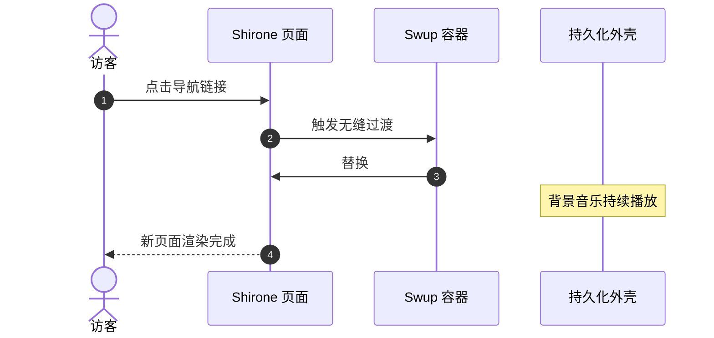

欢迎来到 **Shirone**（白音）—— 一个围绕 **Astro 7**、**Svelte 5** 和 **Material 3 Expressive (M3E)** 设计系统打造的、富有表现力的动漫风格博客主题。

本指南将带你了解文章创建、frontmatter 规范、目录结构，以及完整的内置 Markdown 和 MDX 扩展功能。

:::tip
Shirone 优先进行服务端渲染（SSR-first）。在站内导航时，Swup 会无缝替换主容器，同时保留外层应用外壳和持续播放的音乐。
:::

---

## 1. 创建新文章

你可以使用内置的 CLI 命令快速生成带有标准 frontmatter 的新文章：

```bash
# 创建单文件文章
pnpm new-post my-first-post

# 或在子目录中创建文章
pnpm new-post guides/getting-started
```

新创建的文件将放置在 `src/content/posts/` 目录中。

---

## 2. Frontmatter 规范

每个 Markdown（`.md`）或 MDX（`.mdx`）文章都以 YAML frontmatter 块开头，用于定义其元数据。

### 示例

```yaml
---
title: "探索 Material 3 Expressive 设计"
published: 2026-08-26
updated: 2026-08-27
publishedAt: 2026-08-26T10:00:00+08:00
updatedAt: 2026-08-27T09:30:00+08:00
pinned: true
description: "深入探讨 Shirone 中的动态 HCT 色彩科学与流体过渡。"
image: "./cover.webp"
tags: [M3E, 设计, 前端]
category: 指南
draft: false
comment: true
---
```

### 支持的 Frontmatter 字段

| 字段 | 类型 | 必填 | 描述 |
| :--- | :--- | :---: | :--- |
| `title` | `string` | **是** | 文章的主标题。 |
| `published` | `Date` | **是** | 发布日期，格式为 `YYYY-MM-DD`。 |
| `publishedAt` | `Date` | 否 | 精确的发布时刻，用于对同一天发布的文章进行排序。它必须落在配置的站点时区中的 `published` 日期上。 |
| `updated` | `Date` | 否 | 最后更新日期。提供后，将显示更新通知徽章。 |
| `updatedAt` | `Date` | 否 | 精确的更新时刻，供 feed 和机器可读元数据使用。必须与 `updated` 配对使用。 |
| `pinned` | `boolean` | 否 | 将文章置顶到文章列表顶部（默认值：`false`）。 |
| `description` | `string` | 否 | 文章摘要，显示在文章卡片、搜索结果和 OpenGraph 元数据中。 |
| `image` | `string` | 否 | 封面图片路径。支持相对路径（`./cover.webp`）、公共路径（`/images/cover.jpg`）或远程 URL。 |
| `tags` | `string[]` | 否 | 标签名称数组，用于分类筛选和标签云。 |
| `category` | `string` | 否 | 主分类名称，用于分类索引。 |
| `draft` | `boolean` | 否 | 标记为草稿。草稿文章在生产构建（`pnpm build`）时会被隐藏。 |
| `comment` | `boolean` | 否 | 切换此文章是否显示评论区（默认值：`true`）。 |
| `lang` | `string` | 否 | 语言代码（例如 `en`、`zh_CN`、`ja`），当与站点默认语言不同时使用。 |

---

## 3. 文章加密

Shirone 提供客户端文章加密功能。这是一个静态密码门禁，而非服务端访问控制：加密载荷和资源 URL 仍然可以被公开下载，因此请勿将其用于真正机密文件或受监管的秘密信息。对于私人日记或受限文章，可以在 frontmatter 中指定密码：

```yaml
---
title: "私人研究笔记"
published: 2026-08-26
encrypted: true
password: "your-secret-passphrase"
passwordHint: "最喜欢的动漫角色"
hideHomeContent: true
---
```

- `encrypted`：设置为 `true` 以启用加密；
- `password`：解锁文章所需的密码字符串或数字；
- `passwordHint`：可选的提示信息，显示在密码输入表单上方；
- `hideHomeContent`：隐藏首页上的字数统计和内容预览，以防止数据泄露。

---

## 4. 组织文章文件

Shirone 同时支持基于文件夹的共置布局和单文件布局：

### 文件夹结构（推荐用于本地资源）

将文章及其媒体文件放在一起，可以使资源管理更加直观：

```text
src/content/posts/
├── my-great-post/
│   ├── index.md           <-- 文章内容
│   ├── cover.webp         <-- 封面图片（image: "./cover.webp"）
│   └── diagram.png        <-- Markdown 中引用的内联插图
```

### 单文件结构（轻量级散文）

```text
src/content/posts/
├── hello-world.md
└── quick-thoughts.md
```

---

## 5. 丰富的 Markdown 与 MDX 扩展

Shirone 开箱即用地包含现代 Markdown 扩展：

### 5.1 警告块

使用容器指令来创建提示、技巧、警告和警报：

```markdown
:::tip
使用警告块容器来突出关键要点或最佳实践。
:::

:::warning
使用警告容器来提示潜在陷阱或破坏性变更。
:::
```

### 5.2 GitHub 仓库卡片

使用指令语法嵌入实时、美观的 GitHub 仓库卡片：

```markdown
::github{repo="LyraVoid/Shirone"}
```

::github{repo="LyraVoid/Shirone"}

### 5.3 表现力代码块

增强的代码块具有语法高亮、文件名徽章、行号和选择性行高亮功能：

```typescript title="src/utils/theme.ts" {2,4-5}
// 动态 HCT 色彩令牌推导
import { argbFromHex, themeFromSourceColor } from "@material/material-color-utilities";

const theme = themeFromSourceColor(argbFromHex("#f472b6"));
console.log("Primary color token:", theme.schemes.light.primary);
```

### 5.4 数学排版（KaTeX）

在 Markdown 中直接渲染优雅的 LaTeX 数学符号：

- **行内数学**：$E = mc^2$ 或欧拉公式 $e^{i\pi} + 1 = 0$。
- **块级数学**：

$$
\int_{-\infty}^{\infty} e^{-x^2} \, dx = \sqrt{\pi}
$$

### 5.5 Mermaid 图表

使用纯文本创建流程图、序列图和架构图：



### 5.6 图片画廊与 Fancybox 灯箱

图片会自动集成 Fancybox，实现无损缩放、平移手势和全屏预览：

```markdown

```

---

## 6. 后续步骤与自定义

- **站点配置**：了解 `src/config/siteConfig.ts` 和 [`src/config/README.md`](https://github.com/LyraVoid/Shirone/blob/main/src/config/README.md) 中的全局设置。
- **设计令牌**：在 `DESIGN.md` 和 `docs/m3e-standard.md` 中探索令牌和调色板。
- **反馈与社区**：在 [GitHub Issues](https://github.com/LyraVoid/Shirone/issues) 上分享你的想法和问题
